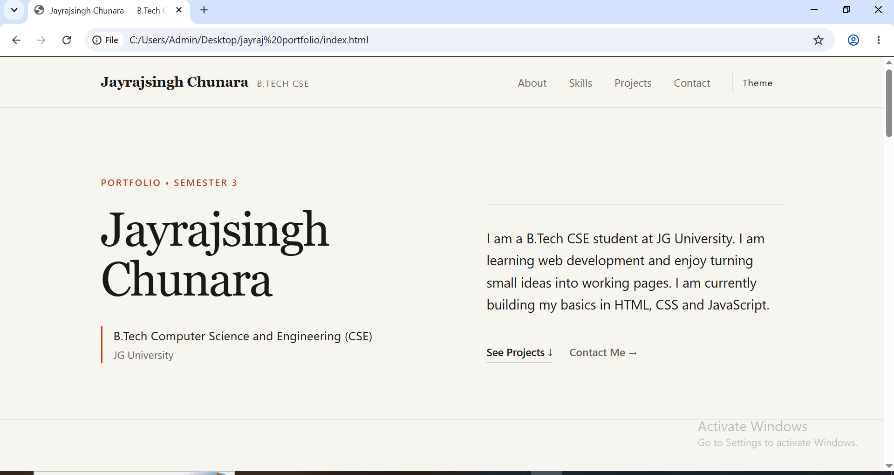

# Jayrajsingh Chunara — Personal Portfolio

A clean, modern, editorial-style personal portfolio website built with semantic HTML5, CSS3, and vanilla JavaScript. Created as a Semester 3 web development college assignment for B.Tech Computer Science and Engineering at JG University.

## Technologies Used
- HTML5 (Semantic elements)
- CSS3 (Variables, Flexbox, CSS Grid, Responsive Design)
- JavaScript (Vanilla ES6, DOM manipulation, Event Listeners, Intersection Observer)
- Git & GitHub (Version control)

## Screenshot

Live link: (add after GitHub Pages is on)

## Project Structure
- `index.html` - Semantic structure containing Home/About, Skills, Projects, and Contact sections.
- `style.css` - Custom styling with CSS variables, vintage editorial aesthetic, responsive layouts, and dark mode support.
- `script.js` - Interactive functionality including theme toggling, mobile navigation, scroll-reveal animations, and form validation.
- `README.md` - Documentation and project overview.
